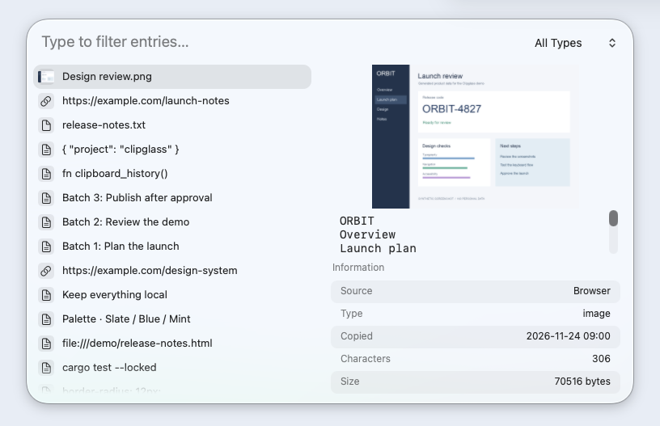

# Clipglass

A keyboard-first clipboard history for macOS, built in Rust with native AppKit views. No webview, account, or cloud service.

<!-- Launch draft: repository and media stay private until explicit approval. -->



[Watch the short demo](docs/media/clipglass-demo.mp4). Every clip in the demo is synthetic.

## What it does

- Keeps local history without an automatic expiry limit.
- Searches text, links, and text recognized inside screenshots with Apple Vision.
- Shows screenshot thumbnails, selectable text, and native Quick Look document previews.
- Opens larger previews with Right Arrow. Pinch to zoom, scroll to pan, or use the Fit and zoom buttons.
- Marks clips with X and pastes them in copy order, oldest first.
- Keeps indentation and blank lines when pasting. Only list titles drop leading whitespace.

## Install from source

**This is a pre-release development build. There is no signed or notarized download yet.**

You need macOS 26 or later, Xcode Command Line Tools, Rust stable, and Python 3. The current build has been tested on Apple Silicon. Intel support has not been verified.

```sh
git clone https://github.com/moritzWa/clip.git clipglass
cd clipglass
cargo build --locked
sh scripts/install.sh "$PWD/target/debug/clip"
```

The repository is private during launch preparation, so cloning currently requires access.

The installer creates `~/Applications/Clip.app` and a per-user launch agent. The app starts hidden, starts at login, and restarts after an exit. The existing `Clip` app, storage, and bundle names are retained for compatibility.

Enable **Clip** in **System Settings → Privacy & Security → Accessibility** for automatic paste. Without that permission, Enter still copies the selected text or first media payload to the clipboard.

Read the [installation and troubleshooting guide](docs/INSTALL.md) for prerequisites, stopping the service, and removing it without deleting history.

## Keyboard controls

The development hotkey is currently tied to physical W: **⌘⇧W on a US keyboard**, or **⌘⇧U on DeutschADNW**. It is not configurable yet. Check for conflicts with other apps.

| Key | Action |
| --- | --- |
| Type | Search history |
| ↑ / ↓ | Browse results |
| X while browsing | Mark or unmark a clip |
| → | Open a larger preview |
| ← | Return to search |
| Enter | Paste the current clip, or all marked clips |
| Escape | Leave the preview, clear marks, or hide the panel |

X still types normally in the search field. Press Left or click the search field to edit a query; Up/Down returns to list browsing.

Closing the panel clears the search, so reopening starts with recent clips.
Returning from a large preview keeps the current query.

Marked clips stay selected across searches and filters. Adjacent text and link clips are joined with a newline. Images and files are pasted as separate native payloads. Switching apps, changing the clipboard, or reopening Clipglass cancels the remaining media queue.

## Local data and privacy

History is stored in `~/Library/Application Support/Clip/`. Text lives in SQLite; images are separate files. Screenshot OCR runs on your Mac. Thumbnails are decoded on a background worker and cached only in memory.

**History is not encrypted. Password-manager exclusions are incomplete.** Tokens, passwords, or other sensitive content copied from a browser or terminal can be saved in history. Do not treat this development build as a secret store.

The app has no application network client, account, sync, or analytics service. Document previews use macOS Quick Look and installed preview extensions.

## Current limits

- Rich-format clipboard preservation and capture of multiple files at once are not verified.
- Browsing uses a cached recent list; paging is not implemented.
- Type filters apply to the current result set, not the whole database.
- Capture, search, and large-file writes can still block the main thread. OCR and thumbnail decoding run off the main thread.
- Mixed/media batches use a 250 ms gap. The destination must accept each type and process pastes within that interval.
- Shortcut configuration, an in-app permissions screen, Developer ID signing, and notarization are not implemented.

## Development

```sh
cargo test --locked
cargo run --locked -- search "example"
```

The search command prints a hit count, not clipboard contents. Search uses token prefixes rather than arbitrary substrings.

GUI checks use synthetic history in an isolated macOS VM. Do not copy personal clipboard databases into a shared test machine. See [testing and measured query timings](docs/TESTING.md).

## License

A proposed MIT license is included in the [private launch packet](docs/launch/LICENSE-MIT.proposed.txt). It is a proposal for approval, not an announcement that this private repository has been released under that license.
