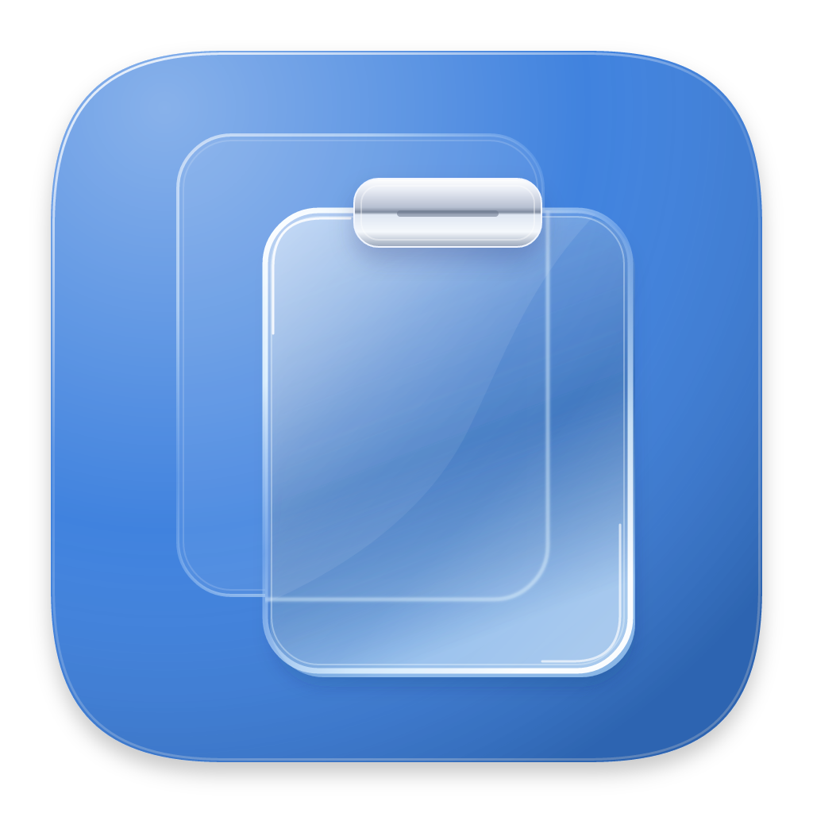
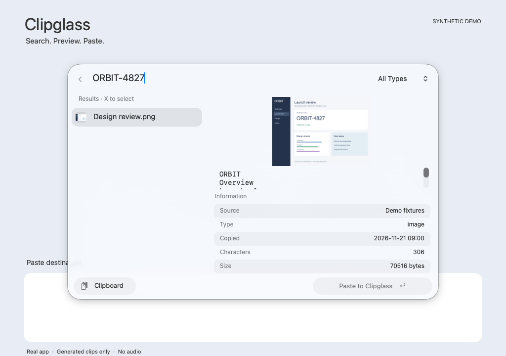
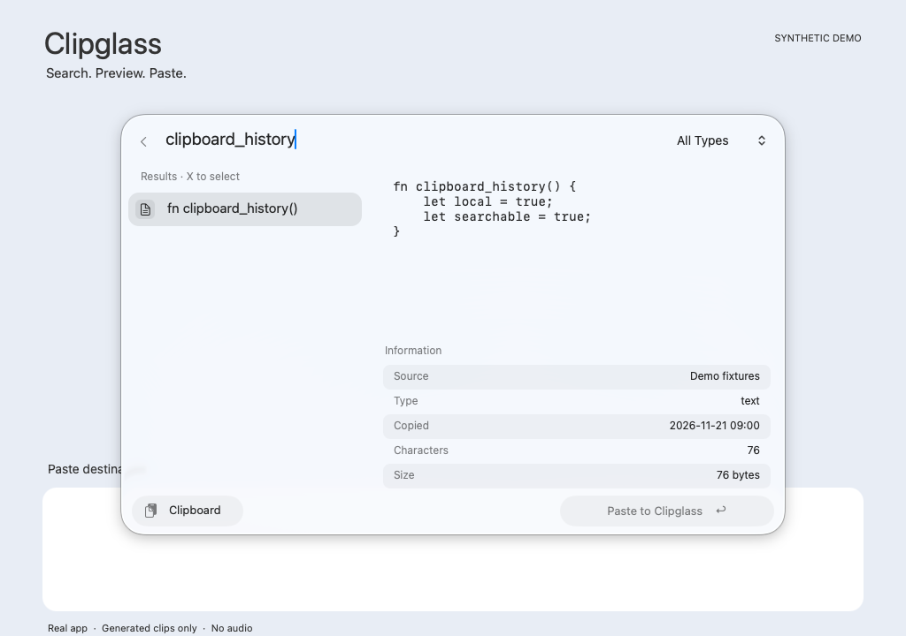
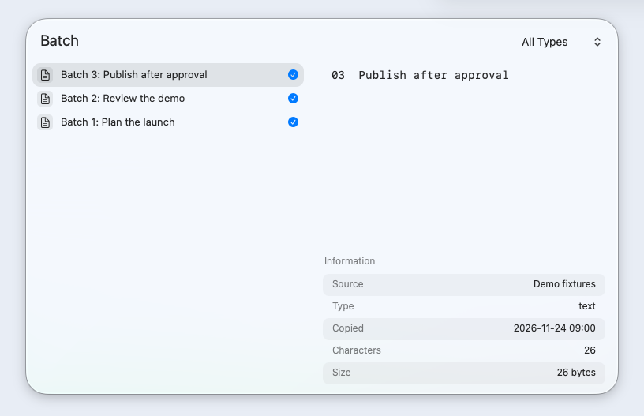
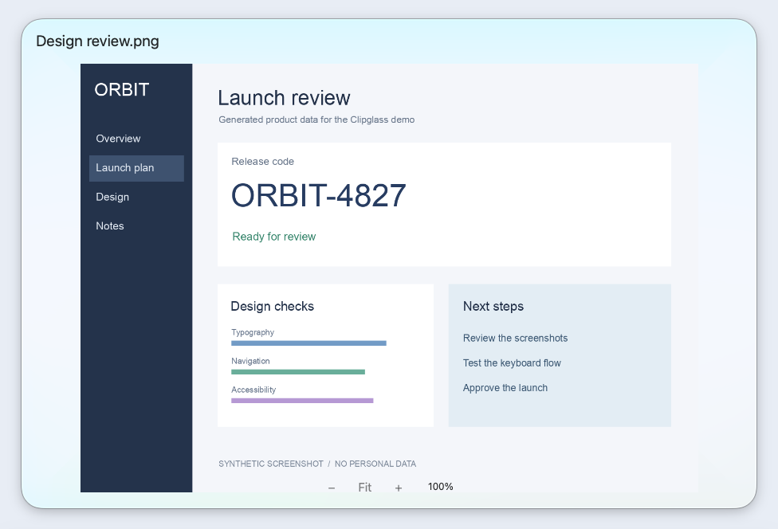

<p align="center"></p>

<h1 align="center">Clipglass</h1>

A keyboard-first clipboard history for macOS, built in Rust with native AppKit views. No webview, account, or cloud service.


[Watch the earlier short demo](docs/media/clipglass-demo.mp4). The screenshots show
the current interface; the video shows an earlier build. All content is synthetic.

## What it does

- Keeps local history without an automatic expiry limit.
- Searches text, links, and text recognized inside screenshots with Apple Vision.
- Shows screenshot thumbnails, including screenshots copied as image files, selectable text, and native Quick Look document previews.
- Opens larger previews with Right Arrow. Pinch to zoom, scroll to pan, or use the Fit and zoom buttons.
- Marks clips with X and pastes them in copy order, oldest first.
- Keeps indentation and blank lines when pasting. Only list titles drop leading whitespace.

## Screenshots

| Search text inside screenshots | Preview code without losing indentation |
| --- | --- |
|  |  |

| Mark several clips for batch paste | Open a larger image preview |
| --- | --- |
|  |  |

## Download and install

**[Download Clipglass for Apple Silicon](https://github.com/moritzWa/clip/releases/download/v0.1.0/Clipglass-0.1.0-macos-arm64.zip)** · [All releases](https://github.com/moritzWa/clip/releases)

Requires **macOS 26 or later** and an **Apple Silicon Mac** (M1 or newer).
No Rust, developer tools, account or subscription is needed for the download.

1. Download and unzip the archive.
2. Drag **Clipglass.app** into **Applications**, then open it.
3. Press **⌘⇧V** to open history, or use the menu-bar clipboard icon.
4. Enable **Clipglass** in **System Settings → Privacy & Security → Accessibility**
   for automatic paste. Without that grant, Enter copies the selected clip instead.

The app is Developer ID signed, notarized by Apple, and includes a stapled
notarization ticket. Checksums are on the release page. To start it at login,
add Clipglass in **System Settings → General → Login Items**.

Your history stays on your Mac. It is not encrypted; read the privacy notes below
before copying sensitive material. The app does not import another clipboard
manager's history automatically.

## Build from source

You need macOS 26 or later, Xcode Command Line Tools, Rust stable, and Python 3. The current build has been tested on Apple Silicon. Intel support has not been verified.

```sh
git clone https://github.com/moritzWa/clip.git clipglass
cd clipglass
cargo build --locked
sh scripts/install.sh "$PWD/target/debug/clip"
```

The installer creates `/Applications/Clipglass.app` and a per-user launch agent. It requires write access to `/Applications`. The app starts hidden, starts at login, and restarts after an exit. Storage and bundle identifiers retain `Clip` for compatibility; an older `~/Applications/Clip.app` is preserved as a backup.

Enable **Clipglass** in **System Settings → Privacy & Security → Accessibility** for automatic paste. Without that permission, Enter still copies the selected text or first media payload to the clipboard.

Read the [installation and troubleshooting guide](docs/INSTALL.md) for prerequisites, stopping the service, and removing it without deleting history.

## Keyboard controls

Fresh installations use **⌘⇧V** for clipboard history and **⌃⌘V** for images.
The image shortcut toggles Images/All Types while the panel is open, keeping your
query. The normal history shortcut reopens All Types. Global shortcuts can
replace app-specific actions, such as plain-text paste, so choose combinations
that suit your workflow.

Open **Settings…** from the menu-bar clipboard icon, or press **⌘,** while
Clipglass is focused. Click a shortcut and press a new combination with Command
or Control. Changes apply immediately and persist across restarts. Escape
cancels recording. Duplicate or unavailable shortcuts are rejected without
replacing the previous bindings. **Restore Defaults** applies the defaults above.

Turn off **Show menu-bar icon** in Settings to hide the icon immediately and
across restarts. Your global shortcuts and focused-app **⌘,** still work.

Existing installations keep their previous shortcuts: the internal
Command+Shift+physical W chord and Cmd+period. Keyboard-layout remappers still
apply. Settings shows the combination that actually reaches the app.

| Key | Action |
| --- | --- |
| Type | Search history |
| ↑ / ↓ | Browse results |
| X while browsing | Mark or unmark a clip |
| → | Open a larger preview |
| ← | Return to search |
| Enter | Paste the current clip, or all marked clips |
| Escape | Leave the preview, clear marks, or hide the panel |
| ⌘, | Open Settings while Clipglass is focused |

X still types normally in the search field. Press Left or click the search field to edit a query; Up/Down returns to list browsing.

Closing the panel clears the search, so reopening starts with recent clips.
Returning from a large preview keeps the current query.

Marked clips stay selected across searches and filters. Adjacent text and link clips are joined with a newline. Images and files are pasted as separate native payloads. Switching apps, changing the clipboard, or reopening Clipglass cancels the remaining media queue.

## Local data and privacy

History is stored in `~/Library/Application Support/Clip/`. Text lives in SQLite; images are separate files. Screenshot OCR runs on your Mac. Thumbnails are decoded on a background worker and cached only in memory.

**History is not encrypted. Password-manager exclusions are incomplete.** Tokens, passwords, or other sensitive content copied from a browser or terminal can be saved in history. Do not treat this development build as a secret store.

The app has no application network client, account, sync, or analytics service. Document previews use macOS Quick Look and installed preview extensions.

## Current limits

- Rich-format clipboard preservation and capture of multiple files at once are not verified.
- Browsing uses a cached recent list; paging is not implemented.
- Type filters search the database before limiting results. Images includes
  image files as well as copied image payloads.
- Capture, search, and large-file writes can still block the main thread. OCR and thumbnail decoding run off the main thread.
- Mixed/media batches use a 250 ms gap. The destination must accept each type and process pastes within that interval.
- An in-app permissions screen and automatic app updates are not implemented.
  Download a newer release and replace the app to update; local history remains.

## Development

```sh
cargo test --locked
cargo run --locked -- search "example"
```

The search command prints a hit count, not clipboard contents. Search uses token prefixes rather than arbitrary substrings.

GUI checks use synthetic history in an isolated macOS VM. Do not copy personal clipboard databases into a shared test machine. See [testing and measured query timings](docs/TESTING.md).

## License

[MIT](LICENSE). Contributions are welcome; see [CONTRIBUTING.md](CONTRIBUTING.md).
